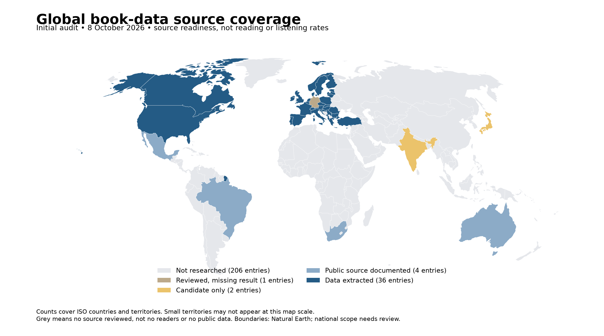

# Global Reading Atlas

A Python project for exploring how people read and listen to books, which genres they choose, and what public data tells us about different markets.

It covers paper books, ebooks and audiobooks, alongside publishers, retailers, subscription services and libraries. The Storytel sections look at new-country entry and growth in existing markets separately.

**[Open the dashboard and reports](https://zeepharaoh.github.io/global-reading-atlas-public/)**

No installation or account is needed for the browser version. This is an independent project using public sources, not an official Storytel publication. It contains no internal Storytel data.



## What's included

- An interactive dashboard with Industry, Audiobooks, Reading, Formats, Genres and Coverage views.
- Two real Python notebooks with saved results and charts.
- Reviewed source data, links, table/page references and measurement notes.
- A company register and published industry revenue series.
- Checks for missing values, source definitions and changes to the evidence.

The country roster covers 249 countries and territories. That is a research roster, not complete data coverage. The reviewed company register currently contains 23 companies and services, with parent and brand overlap kept visible.

## Run the dashboard locally

Requires Python 3.12 or newer. No Python packages or JavaScript tools are needed to view the committed dashboard.

```bash
git clone https://github.com/zeepharaoh/global-reading-atlas-public.git
cd global-reading-atlas-public
python3 main.py serve --open-browser
```

On Windows, use `py -3 main.py serve --open-browser` for the last command.

The local address is `http://localhost:4173/`. Keep the terminal open while using it and press Ctrl+C to stop. If the port is busy, add `--port 4174`.

That local address works on your own computer. Share the public browser link with other people.

You can also choose **Code → Download ZIP** on GitHub, extract the full folder, then run the last command from the folder containing `main.py`. Keep the whole project together, including `dashboard/dist/` and its JSON file.

Use any editor you prefer. [The setup and sharing guide](docs/SHARING.md) covers the browser, terminal, JupyterLab and VS Code.

## Work with the notebooks

- [Audiobook market analysis](notebooks/02_audiobook_market_check.ipynb)
- [Reading and listening analysis](notebooks/01_reading_and_listening_analysis.ipynb)

Both notebooks use the same reviewed evidence as the dashboard. You can preview their saved results on GitHub, or read the reports in the browser edition.

To run or edit them, create a Python environment. The commands below also install [JupyterLab](https://jupyter.org/install), which opens the notebooks in your browser.

macOS / Linux:

```bash
python3 -m venv .venv
.venv/bin/python -m pip install ".[analysis]" jupyterlab
.venv/bin/python -m jupyterlab
```

Windows:

```powershell
py -3 -m venv .venv
.venv\Scripts\python.exe -m pip install ".[analysis]" jupyterlab
.venv\Scripts\python.exe -m jupyterlab
```

In JupyterLab, open either `.ipynb` file from `notebooks/`, use the Python kernel from this environment, then run all cells. The notebooks work from cached data and do not need Storytel access.

For **VS Code**, open the project folder, install the Microsoft Python and Jupyter extensions, then open a notebook and use **Select Kernel** to choose the project `.venv`. See the [official notebook guide](https://code.visualstudio.com/docs/datascience/jupyter-notebooks).

**PyCharm is optional:** open the same folder, select the project `.venv` interpreter and notebook kernel, and run the notebook. Saved dashboard and analysis run configurations are included in `.run/`.

## Data and limitations

Main sources include Eurostat, Pew Research Center, BookNet Canada, Singapore's National Library Board, Nordic media surveys, the Audio Publishers Association, the Association of American Publishers, the UK Publishers Association and official company releases. Links and definitions are in [the source register](data/source_register.json).

The main observation window starts in 2022. Older US observations are retained as historical context. A source-check date is separate from the year a survey describes. New observations are added only when published evidence can be checked; missing years are not estimated.

A few rules matter when reading the charts:

- Annual participation, daily reach and preferences among existing readers or listeners measure different things.
- Print, ebook and audiobook audiences overlap. Their percentages cannot be added together.
- Genre questions can allow multiple answers; these percentages are not shares of books sold or listened to.
- Survey populations and methods differ across countries and years. A country ranking is not valid unless the bases are comparable.
- Company-wide revenue, audiobook revenue, subscribers and publisher sales stay separate. Parent and brand records can overlap.
- Planned launches and announced acquisitions are distinguished from completed operations.

The Canadian 2024 and 2025 waves remain separate. The 2025 report was published in May 2026 and covers an unweighted English-speaking adult reader panel, not the whole Canadian population. US 2025 participation is shown separately from the earlier telephone-survey series because the survey method changed.

The Storytel case studies support further research. Public survey evidence alone does not establish the best country to enter. Pricing, catalogue rights, competition, acquisition cost, retention and margins also matter.

## Update or extend the project

To get the latest version, download a fresh ZIP or clone the repository into a new folder. Keep a separate copy of any notebooks or changes you want to save. The public repository is shared as one release snapshot, so an older clone may need to be replaced rather than updated with Git pull.

To suggest a source, include its official URL, observation year, table/page, metric, unit, geography, population and recall period. Open a GitHub issue or submit a pull request.

[Maintainer instructions](docs/MAINTAINING.md) cover validation, notebook reports, evidence refreshes, dashboard source builds and browser deployment. Viewing the dashboard uses the committed build; running the notebooks uses the Python environment above.

## Source rights

Original reports and microdata retain their publishers' rights. Survey PDFs are not redistributed. Natural Earth geometry is [public domain](https://www.naturalearthdata.com/about/terms-of-use/). Keep the [third-party dependency notices](THIRD_PARTY_NOTICES.txt) with redistributed application files. This repository does not grant a blanket license over third-party material.
